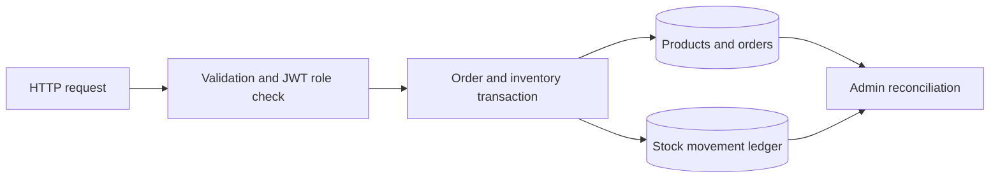

# OrderFlow — Inventory-aware Order API

[](https://github.com/boyhoanghoi/orderflow/actions/workflows/test.yml)

**Python backend portfolio: place orders, prevent duplicate checkout, reverse stock on cancellation, and reconcile every inventory change.**

FastAPI · SQLAlchemy · SQLite · JWT · Argon2 · Pytest · Docker

[Tiếng Việt](README.vi.md) | [Design](docs/design.md) | [Inventory support](docs/inventory-support.md) | [Tests](tests/test_inventory.py)

## Start with a reproducible demo

Python 3.12+:

```bash
git clone https://github.com/boyhoanghoi/orderflow.git
cd orderflow
python -m venv .venv
# Windows PowerShell: .venv\Scripts\Activate.ps1
# macOS/Linux: source .venv/bin/activate
pip install -r requirements-dev.txt
python scripts/demo.py
python -m pytest -q
```

The demo calls the real application with a temporary SQLite database and random temporary credentials. It creates 10 units, sells 3, replays the same request, then cancels. Output shows stock `10 → 7 → 10`, movement deltas `[10, -3, 3]`, and reconciliation difference `0`. No deployed service or existing database is used.

## Why these details matter

| Failure case | Implemented behavior |
| --- | --- |
| A checkout request is retried | Same user + key + items returns the original order; changed items return 409 |
| One of several products is unavailable | Roll back the complete order, stock updates and movement rows |
| A customer cancels twice | Only a placed order can transition; stock is restored once |
| Product prices later change | Order lines retain the product name and integer price snapshot |
| Support needs to explain stock | Admin can inspect movements and compare actual vs ledger stock |
| Another customer guesses an order ID | Order details and cancellation check ownership; unauthorized access returns 404 |



## Run the interactive API

Copy `.env.example` to `.env` (`Copy-Item .env.example .env` on PowerShell). Replace `JWT_SECRET` with a random value of at least 32 characters, and choose local admin credentials. Then:

```bash
uvicorn app.main:app --reload --env-file .env
```

Open [Swagger UI](http://127.0.0.1:8000/docs). Alternatively use `docker compose up --build` with the same `.env`. Obtain a token with `POST /auth/login`; enter it in Swagger's **Authorize** control. Register a separate customer for checkout. Send an `Idempotency-Key` of 8-128 characters when placing an order.

| API | Access |
| --- | --- |
| POST `/auth/register`, `/auth/login`; GET `/products`, `/health` | Public |
| POST `/products`; PATCH `/products/{id}/stock` | Admin |
| POST `/orders`; GET `/orders` | Authenticated user; list is own orders |
| GET `/orders/{id}`; POST `/orders/{id}/cancel` | Owner or admin |
| POST `/orders/{id}/ship` | Admin |
| GET `/inventory/movements`; GET `/inventory/reconciliation` | Admin, paginated |

Order request example: `{"items":[{"product_id":1,"quantity":2}]}`. Inspect complete schemas and status codes in `/openapi.json`.

## Verification

CI runs API tests on Python 3.12 and 3.13, then executes the isolated demo. Download the `api-evidence-*` artifact from an [Actions run](https://github.com/boyhoanghoi/orderflow/actions) for JUnit results and actual demo JSON. The badge reflects the latest run, not an invented pass count.

Tests exercise transaction rollback, idempotency, ownership, status transitions, rejected adjustments, ledger traceability, filtering and deliberate stock drift. See [acceptance mapping](docs/inventory-support.md).

## Scope

Personal learning project for internship applications. This is a small sales/inventory module, not a complete ERP or a production deployment. SQLite is for demonstration; PostgreSQL concurrency tests, schema migrations, rate limiting and operations work remain future improvements. Existing pre-1.1 demo databases need a deliberate ledger baseline; see [upgrade notes](docs/inventory-support.md#existing-demo-databases).

For ERP master-data checks and support/UAT practice, see [ERP Support Toolkit](https://github.com/boyhoanghoi/erp-support-toolkit).
