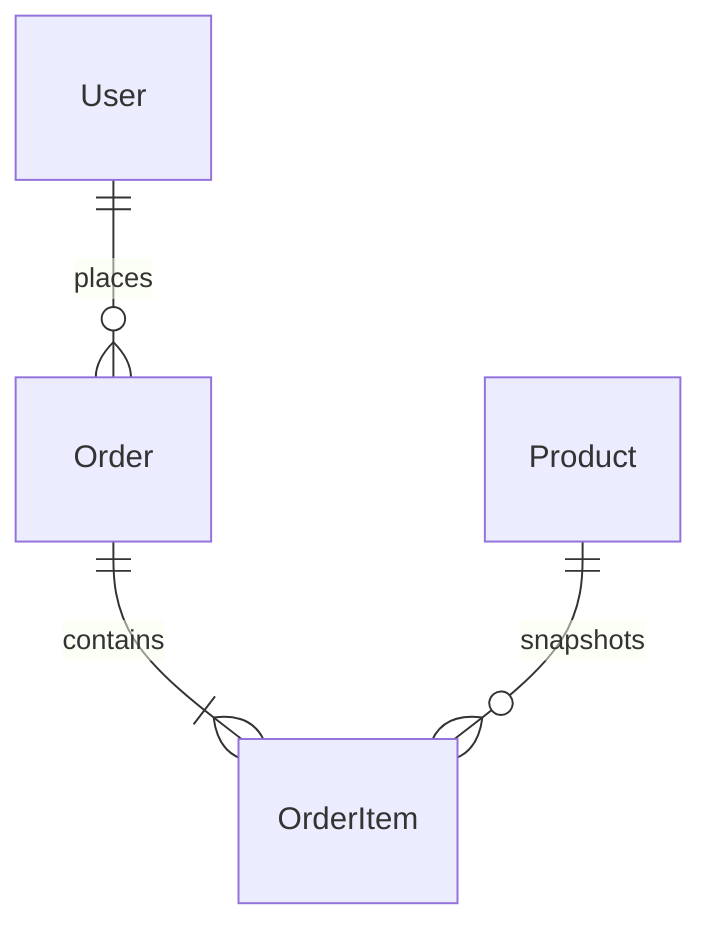

# Thiết kế OrderFlow

## Invariant nghiệp vụ

- `Product.stock >= 0`. Cập nhật stock dùng `UPDATE ... WHERE stock >= quantity` và kiểm tra `rowcount`, tránh lỗi đọc rồi ghi đè khi nhiều request đến cùng lúc.
- Tất cả dòng đơn và thay đổi stock được commit hoặc rollback cùng nhau. Không thể có đơn thành công khi một sản phẩm thiếu hàng.
- `(user_id, idempotency_key)` duy nhất. Mỗi key gắn với hash của danh sách sản phẩm/số lượng đã chuẩn hóa; gửi lại khác nội dung trả `409`.
- Giá, tên sản phẩm được chụp vào `OrderItem` tại thời điểm đặt, nên đơn cũ không thay đổi nếu danh mục thay đổi.
- Hủy và giao hàng chỉ hợp lệ khi đơn đang ở trạng thái `placed`; hủy cộng stock lại một lần.

## Quyết định kỹ thuật

- Giá tiền dùng số nguyên cent để tránh lỗi làm tròn số thực.
- JWT hết hạn sau 8 giờ, mật khẩu băm bằng Argon2. Chỉ admin được thêm sản phẩm, chỉnh stock và giao hàng.
- DB SQLite cho demo local; production cần PostgreSQL, migration, cơ chế giám sát và kiểm thử đồng thời trên DB mục tiêu.

## API chính

| Method | Path | Quyền |
| --- | --- | --- |
| POST | `/auth/register`, `/auth/login` | Công khai |
| GET | `/products` | Công khai |
| POST | `/products` | Admin |
| PATCH | `/products/{id}/stock` | Admin |
| POST | `/orders` | Đã đăng nhập; cần `Idempotency-Key` |
| GET | `/orders`, `/orders/{id}` | Chủ đơn hoặc admin khi xem chi tiết |
| POST | `/orders/{id}/cancel` | Chủ đơn hoặc admin |
| POST | `/orders/{id}/ship` | Admin |

Swagger UI: `/docs`. Endpoint đầy đủ và schema nằm trong `/openapi.json`.
